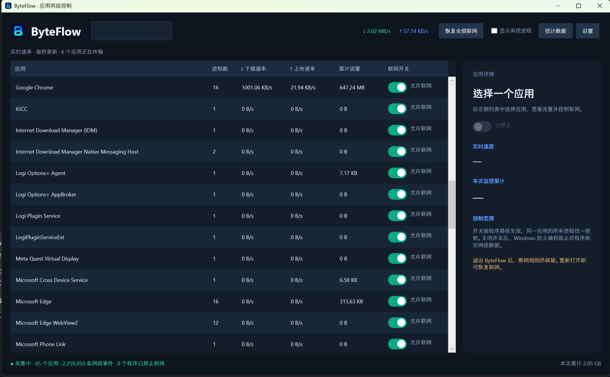

<div align="center">
  
  <h1>ByteFlow</h1>
  <p>看清哪个应用在用网，一键决定它能否联网。</p>
  <p>A Windows network monitor with per-app internet controls.</p>
  <p><a href="https://github.com/hxmsuper/ByteFlow/releases/latest">下载 Windows 版</a> · <a href="#快速开始">快速开始</a> · <a href="#从源码构建">从源码构建</a></p>
</div>

<p align="center">
  
</p>

ByteFlow 是一款 Windows 桌面工具，把应用网速、流量用量和联网开关放在同一个界面里。想知道谁在后台上传、哪个软件占用带宽，或临时让某个应用断网，都可以在列表中查看和操作。

## 可以做什么

| 功能 | 说明 |
| --- | --- |
| 实时网速 | 每秒更新各应用的下载、上传速率，支持按速率排序并随数据变化自动调整顺序 |
| 应用聚合 | 同一可执行程序的多个进程合并显示，默认隐藏系统进程 |
| 关注与隐藏 | 关注应用以金色星标区分并置顶；可只看关注、隐藏应用及恢复显示 |
| 详情面板 | 默认收起，打开或关闭时窗口同步调整宽度 |
| 联网开关 | 允许或阻止指定程序联网，也可一键恢复全部 |
| 用量统计 | 按应用、日期保存上传和下载用量，查看今天或全部记录 |
| 数据清理 | 清理单个应用或全部历史统计，不改变联网规则 |
| 双语界面 | 设置中即时切换中文 / English，并记住选择 |

## 快速开始

1. 从 [Releases](https://github.com/hxmsuper/ByteFlow/releases/latest) 下载 `ByteFlow-v0.1.1-win-x64.zip`。
2. 解压完整文件夹，运行 `ByteFlow.exe`，允许 Windows 管理员权限提示。
3. 打开网页或开始下载，在应用列表中查看实时速率；选择应用可查看详情。
4. 关闭应用旁的联网开关即可阻止该程序联网，重新打开开关即可恢复。

**运行环境：Windows 10 / 11，x64。** Release 包已包含 .NET 运行环境，无需另外安装 .NET。联网控制需要 Windows 防火墙处于启用状态。

> 断网规则在退出 ByteFlow 后仍然有效。退出前可点“恢复全部联网”，或下次打开时恢复。恢复操作只删除 ByteFlow 创建的规则。

## 统计数据与隐私

- 统计覆盖 ByteFlow 运行期间观测到、能够归属到应用的网络流量，不补录软件关闭期间的数据。
- “本次累计”随本次运行结束；“统计数据”中的记录会保留，约每 15 秒保存一次，正常退出时再次保存。
- 清理统计不会影响实时速率或防火墙规则；清理后从新流量开始累计。异常退出可能丢失最后约 15 秒记录。
- 数据保存在本机 `%LOCALAPPDATA%\ByteFlow\`：`usage.json` 是统计记录，`language.txt` 是语言设置。新版会阻止重复启动；请先退出旧版本再启动新版。
- 使用 Windows ETW 采集 TCP / UDP、IPv4 / IPv6 网络事件，不读取通信内容。统计记录保存在本地。

显示偏好保存在同目录 `view.json`，隐藏应用只影响列表，不停止统计或断网。右键应用可关注或隐藏。新版启动时会清理确认所属进程已经退出的 ByteFlow 遗留采集会话，不停止其他软件的会话。

## 使用边界

- 断网按可执行文件路径生效，覆盖该路径的所有进程。浏览器、启动器、更新器使用不同程序文件时，需要分别控制。
- 系统进程分类使用路径和会话信息，第三方后台助手仍可能显示。无法读取路径的进程只能查看，不能控制。
- 进程列表约每 5 秒更新；速率每秒更新。没有传输时显示 `0 B/s`，采集未启动或失败时显示 `—` 和状态提示。
- ETW 统计与网卡计数或运营商计费可能不同，高负载时可能丢失事件。PID 复用可能影响本次会话的累计归属；跨午夜的采样记入采样结束日期。
- 本机回环、代理、VPN 及既有连接可能受到 Windows 防火墙行为的影响；此工具不作为安全隔离方案。

## 从源码构建

需要 Windows 和 .NET 8 SDK。首次还原依赖需访问 NuGet。

```powershell
dotnet restore
dotnet build -c Release
dotnet publish ByteFlow.csproj -c Release -r win-x64 --self-contained true -o dist/win-x64
```

以管理员身份运行终端，执行采集验证：

```powershell
dotnet run --project tests/ByteFlow.Smoke.csproj
```

测试包括统计保存与清理，以及 8 MiB 本机回环传输的进程归属检查，不修改防火墙规则。仅测试统计存储可加 `-- --storage-only`，无需管理员权限。

## English

ByteFlow shows live download/upload rates for each Windows application and lets you allow or block its internet access. It includes daily usage records, per-app or full history clearing, and a Chinese/English interface.

Download the **Windows x64 ZIP** from [Releases](https://github.com/hxmsuper/ByteFlow/releases/latest), extract the entire folder, and run `ByteFlow.exe` as administrator. The .NET runtime is included. Windows Firewall must be enabled for network controls. Blocks remain active after closing the app; reopen ByteFlow to restore access. Usage is recorded only while ByteFlow runs and is stored locally.
